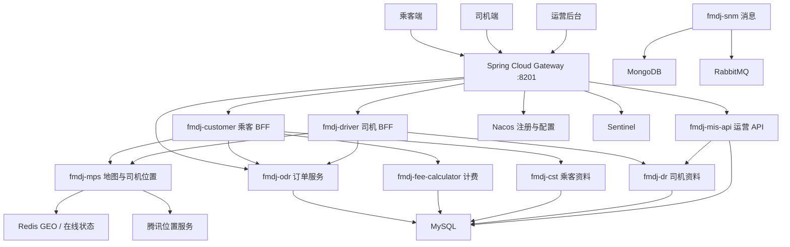
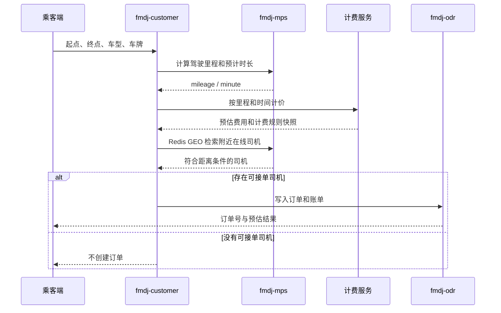

# 飞马代驾

面向乘客、司机和运营后台的代驾平台。乘客下单后，系统实时估算里程与费用，并用 Redis GEO 在附近在线司机中筛选可接单司机；司机端负责认证、位置上报和工作台，运营端负责组织、权限和司机审核。

技术栈：Java 15 · Spring Boot 2.3 · Spring Cloud Hoxton · Spring Cloud Alibaba · Nacos · Gateway · OpenFeign · Sentinel · Sa-Token · MyBatis · Redis · MySQL · MongoDB · RabbitMQ · Quartz · MinIO · 腾讯位置服务 · 微信支付

## 适合网申的项目描述

独立完成一套代驾业务的微服务拆分。乘客创建订单时，通过 OpenFeign 串联地图、计费和订单服务：腾讯地图计算预估里程和时长，计费服务按里程、时长和返程规则报价，Redis GEO 按距离召回在线司机，并用 WGS84 椭球距离做 3 公里可达性校验。订单写入使用本地事务和 TX-LCN 分布式事务注解。网关统一接入乘客端、司机端和运营端，Sentinel 做限流熔断，Sa-Token 结合 Redis 管理登录态。

## 核心亮点

- **下单链路一次编排完成估价和派单预检。** 乘客端不把里程、价格和司机可用性拆成三次前端请求，而是在创建订单时依次调用地图、计费和附近司机检索，只有存在可接单司机才落订单。
- **司机位置用 Redis GEO 维护。** 位置缓存约 60 秒，用于判断司机是否仍在线；检索时按公里半径、距离升序返回，Redis 异常时返回空结果，避免派单流程被缓存故障打断。
- **计费规则可追溯。** 报价同时保留规则 ID、起步里程、超出里程单价、起步时长、超时单价和返程单价，订单账单能够回看当时的计价依据。
- **接入层和业务层分离。** `fmdj-customer`、`fmdj-driver`、`fmdj-mis-api` 作为 BFF，领域数据放在 `fmdj-cst`、`fmdj-dr`、`fmdj-odr` 等服务中，服务之间用 OpenFeign 调用。
- **网关具备服务发现、跨域和流量防护。** Gateway 按路径转发到乘客、司机、运营和订单服务，并开启 Sentinel。
- **消息、文件和定时任务按场景选型。** 系统通知使用 MongoDB 与 RabbitMQ，司机证件走对象存储，订单侧使用 Quartz。

## 系统架构



## 创建订单



## 模块

| 模块 | 端口 | 职责 |
| --- | --- | --- |
| `gateway` | 8201 | 统一入口，按 `/fmdj-customer`、`/fmdj-driver`、`/fmdj-mis-api`、`/fmdj-odr` 转发 |
| `fmdj-customer` | 8102 | 乘客注册登录、车辆、创建订单 |
| `fmdj-driver` | 8101 | 司机注册、认证、登录、工作台、位置上报、证件上传 |
| `fmdj-mis-api` | 8010 | 部门、用户、角色、权限和司机实名审核 |
| `fmdj-cst` | 8007 | 乘客与车辆领域服务 |
| `fmdj-dr` | 8001 | 司机资料、认证和接单设置 |
| `fmdj-odr` | 8002 | 订单、账单、申诉、评价、监控和分账数据 |
| `fmdj-mps` | 8004 | 路线规划、里程时长、Redis GEO 附近司机 |
| `fmdj-fee-calculator` | — | 代驾费用计算 |
| `fmdj-snm` | 8003 | 系统消息，MongoDB 存消息，RabbitMQ 投递 |
| `fmdj-vhr` | 8008 | 代金券数据模型 |
| `fmdj-oes` | 8005 | 订单执行服务骨架 |
| `fmdj-nebula` | 8009 | MinIO 对象存储接入 |
| `fmdj-tm` | — | 已纳入父工程，业务接口仍在扩展 |
| `common` | — | 统一返回、XSS 过滤、COS 与微信支付工具 |

## 主要能力

### 乘客

- 注册、登录。
- 维护常用车辆。
- 提交起终点后获得里程、时长、费用和可接单司机结果。

### 司机

- 注册、登录、退出。
- 提交认证资料，运营端审核实名信息。
- 上报位置到 Redis，查询工作台和当日业务数据。
- 上传或删除私有证件文件。

### 运营

- 部门、账号、角色、权限维护。
- 分页查询司机并审核实名认证。
- Sa-Token 登录态存放在 Redis。

## 本地运行

依赖：JDK 15、Maven、MySQL、Redis、Nacos。消息、MongoDB、MinIO、Sentinel 按实际启用的模块准备。

```bash
mvn clean package -DskipTests
```

先启动 Nacos 和数据库，再启动领域服务，最后启动 BFF 与 `gateway`。网关默认监听 `8201`，配置中心地址、数据库和第三方密钥放在各模块的 `application.yml` 或 Nacos 中，不要把真实密钥提交到仓库。

乘客创建订单示例：

```http
POST /fmdj-customer/order/createNewOrder
Content-Type: application/json
```

## 工程说明

父工程是 Maven 多模块，Java 版本为 15，Spring Boot 为 `2.3.7.RELEASE`，Spring Cloud 为 `Hoxton.SR9`，Spring Cloud Alibaba 为 `2.2.2.RELEASE`。

`fmdj-oes`、`fmdj-nebula`、`fmdj-tm` 目前主要是服务注册和基础设施接入，对外业务接口还不多。创建订单接口里的登录校验目前保留了调试用的固定乘客 ID，接入真实环境前应恢复 Sa-Token 登录态。
